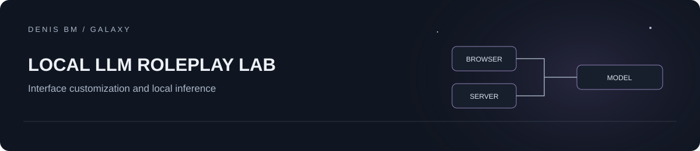

# Local LLM Roleplay Lab

A local-model roleplay setup built around [SillyTavern](https://github.com/SillyTavern/SillyTavern), with a simplified chat interface and documented local/LAN deployment boundaries.

**Contribution:** interface customization, integration and deployment configuration. SillyTavern, inference engines and model weights are third-party components; this project does not claim their authorship or model training.

## Project context

This personal setup and its custom extension were assembled with AI assistance. The repository presents a learning project around existing tools, with upstream attribution retained. It does not represent independent development of SillyTavern or the language models.

## Architecture

```text
Browser -> SillyTavern -> local text-generation API -> user-selected model
                 |
           CleanUI extension
```

## Included

- `CleanUI/`: browser-side presentation extension, extracted and revised from the supplied setup.
- `examples/roleplay-character.json`: a new fictional character template with no personal conversations.
- `docs/LOCAL_SETUP.md`: deployment checklist and separation between UI simplification and access control.

No chat history, tokens, cookies, API credentials, personal character cards, model weights, `node_modules`, third-party extensions or complete upstream server copy is included.

## Try the extension

1. Install SillyTavern from its upstream repository using its current official instructions. The archived setup identified itself as version 1.18.0; compatibility with later UI selectors must be checked.
2. Copy `CleanUI` into `public/scripts/extensions/third-party/CleanUI` in your local SillyTavern installation.
3. Start SillyTavern, enable third-party extensions as described by upstream, and reload the page. The extension manifest loads `index.js` and `style.css`.
4. Use the **Advanced UI** button or **Alt+Shift+U** to reveal the hidden settings. Preferences are stored only in this browser's local storage.
5. Connect a local backend supported by SillyTavern. The character JSON is a human-readable example to enter in the character editor, not a promise of native card-format import compatibility.

CleanUI hides controls through CSS. **It does not authenticate users or restrict access to server APIs.** A person can reveal the controls. Use the upstream authentication and network settings before allowing LAN access.

## Validation

```sh
node --check CleanUI/index.js
python -m json.tool CleanUI/manifest.json
python -m json.tool examples/roleplay-character.json
```

Syntax and manifest checks pass. Inference quality depends on the chosen model, runtime and hardware; no latency or model-quality benchmark is claimed. The revised extension still needs a compatibility check in the user's chosen upstream version.

## Attribution and license

This repository contains the setup's custom presentation extension and new documentation. SillyTavern is an independent AGPL-3.0 project. CleanUI is distributed under AGPL-3.0 in this release; see [LICENSE](LICENSE). Other extensions from the archive are deliberately excluded. Models and inference engines keep their own licenses.
