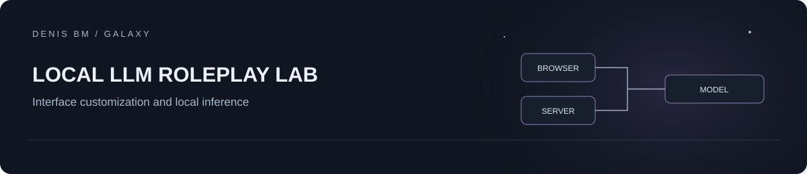

# SillyTavern / Local LLM Lab

Локальная сборка ролевого чата. Модели Llama и Qwen запускаются через LM Studio и отвечают в интерфейсе SillyTavern. Роль персонажа, манеру общения и сценарии диалогов можно задавать отдельно от модели.

[Пример персонажа](examples/roleplay-character.json) · [CleanUI](CleanUI) · [Настройка](docs/LOCAL_SETUP.md) · [English](README.en.md)

## Мой вклад

- Подключил локальный сервер модели к SillyTavern, настроил ролевого персонажа и сценарии диалогов.
- Доработал расширение CleanUI для упрощённого интерфейса. Переключатель Advanced UI возвращает дополнительные настройки.
- В личной сборке подключил ComfyUI для создания изображений прямо в чате. Репозиторий содержит CleanUI, вымышленный пример персонажа и инструкции по локальному текстовому инференсу.

## Как посмотреть

Установите [SillyTavern](https://github.com/SillyTavern/SillyTavern) по его инструкции и подключите поддерживаемый локальный сервер модели. Скопируйте каталог `CleanUI` в `public/scripts/extensions/third-party/CleanUI`, включите сторонние расширения и обновите страницу. Настройки можно вернуть кнопкой **Advanced UI** или сочетанием **Alt+Shift+U**.

Пример персонажа можно перенести вручную через редактор. Совместимость расширения зависит от версии SillyTavern. Для локальной сети нужны штатные настройки доступа SillyTavern. CleanUI управляет показом элементов интерфейса. [Инструкция по настройке](docs/LOCAL_SETUP.md).

SillyTavern, ComfyUI, LM Studio и модели — сторонние компоненты. Сборка и расширение подготовлены с помощью AI. Для опубликованного кода CleanUI действует [AGPL-3.0](LICENSE).
